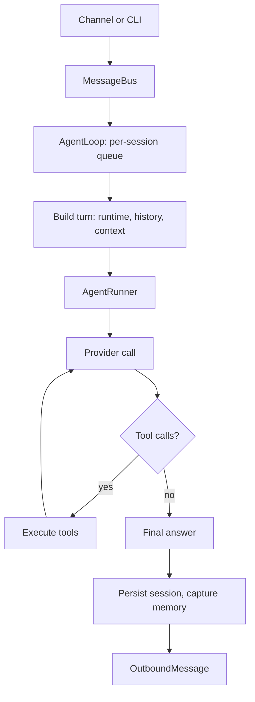

# Mason

**A lightweight, self-hosted personal AI agent framework** — built by Mochi-Sora.

Mason lives in your terminal and in your chat apps. It keeps its prompt small, remembers
what matters, and stays out of the way.

```bash
curl -fsSL https://raw.githubusercontent.com/Mochi-Sora/MasonAgent/main/scripts/install.sh | sh
mason agent -m "hello"    # the wizard sets up the provider and model first
```

> The project is **Mason**. The Python package and CLI still ship under the `mason`
> name while the rename lands, so every command in this document starts with `mason`.

---

## ⭐ Flagship: session-first context

Most agents grow their prompt as the conversation grows. Mason does the opposite.

After every turn, the framework asks the model to summarize four things into the session
state: the current goal, what has been done, what is next, and what the session is
about. The result lives in `memory/state/<session>.md` (4 KB default) and is injected into
the system prompt on every turn; the full conversation is **not**. The model no longer has
to decide whether to update the state — the framework does that — but it can still correct
the state through the capability-gated `update_state` tool.

The result:

- **The prompt stays small** no matter how long the relationship gets. Only the state block
  rides along every turn (≤4 KB by contract).
- **The agent stays oriented.** Goals, completed work, next steps, and the current thread
  are always in front of it instead of buried 200 messages back.
- **Nothing is lost when it is not in the state.** Every turn is captured in a permanent
  journal, and a consolidation pass promotes what deserves to live longer.
- **Nothing is cleared silently.** The state survives the daily rollover; only an explicit
  `/state clear` removes it.

The state is a cache of what matters now — not the memory of record. That distinction is
what makes the rest of the architecture coherent: memory is looked up on demand, and the
prompt only carries the present.

---

## How the architecture works

### One turn, end to end



1. **Ingress** — chat channels (`telegram`, `discord`, `slack`, `feishu`, `matrix`, `signal`,
   `whatsapp`, `qq`, `napcat`, `weixin`, `wecom`, `dingtalk`, `email`, `linear`, `mochat`,
   `msteams`, `mattermost`) and the CLI publish `InboundMessage` events onto an async
   `MessageBus`.
2. **Admission** — `AgentLoop` routes each message to its session's inbox. Sessions are
   strictly serialised (one turn at a time), different sessions run in parallel, and messages
   that arrive mid-turn are folded into the running turn.
3. **Context** — the system prompt is assembled from identity and platform policy, the
   workspace profile (`AGENTS.md`, `SOUL.md`, `USER.md`), the tool contract, the memory
   contract, and the session state. Prompt prefixes are kept stable on purpose, so provider
   prompt caching keeps working.
4. **Execution** — `AgentRunner` runs the model/tool loop: request, act, observe, repeat,
   with compaction, retries, checkpoints, and mid-turn message injection.
5. **Egress** — the reply is published back to the originating channel, the session is
   saved, and the turn is captured into memory.

### Memory: one tier, two representations

| Surface | Where | Lifetime | Written by | Read with |
|---|---|---|---|---|
| Session state | `memory/state/<session>.md` | Persists until explicitly cleared | The framework (model-correctable) | Injected into the prompt |
| Structured knowledge | `memory/memory.db` | Durable | Consolidation | `recall_memory` |
| Verbatim journal | `memory/memory.db` | Durable, unbounded | Every turn, verbatim | `recall_journal` |

- **One store.** The database is the single memory tier: a permanent verbatim journal plus
  structured facts, events, summaries, relationships, and open knowledge gaps derived from it.
  Nothing is purged on a schedule; the backup is for corruption recovery, not a second tier.
- **Consolidation is the memory pass.** Every two hours, a model pass (the main model, or a
  cheaper model you choose) reviews new journal entries and returns a bounded JSON plan:
  promote durable facts, deduplicate, resolve or flag contradictions, connect related
  memories, synthesise broader memories, assess retention, record knowledge gaps, and distil
  tiny reusable skills into `skills/`. It is cursor-gated, so an idle agent costs nothing.
- **The rollover** first runs a narrow nightly pass — deduplicate structured memories and flag
  contradictions, nothing else — then writes a compressed, lossless full copy of the database to
  `<workspace>/backups/memory/`, and runs SQLite optimisation. The journal, structured memory,
  and every session state are untouched.
- **Recall is on demand.** The model is told, in its prompt, that it must search before
  claiming it does not remember something.
- Retrieval is SQLite FTS5 — millisecond lookups, not file scans. The memory subsystem is
  currently unsupported on Windows.

### Capabilities on demand

Only a handful of tools are always in the prompt (`find_capabilities`, `recall_memory`,
`recall_journal`). Everything else — files, shell, web, schedules, sessions, image generation,
state editing, MCP tools — is registered but hidden until the model asks for it:

```text
find_capabilities(need="schedule a daily reminder")  ->  cron (+ the cron skill)
```

The names-only catalog lives inside that tool's description, and matched tools are loaded for
the rest of the run. In practice this cuts the tool payload from ~6,600 to ~1,400 tokens per
request while the model still knows what exists. `tools.lazyCapabilities.enabled: false`
restores the classic always-loaded behaviour.

### Sessions, providers, interface

- **Sessions** are persisted per conversation (`<config-dir>/sessions/<workspace-id>/`), with
  TTL-based idle auto-compaction and `/compact`. Compaction is a safety valve for oversized
  turns; when it runs, the archived summary it writes is injected into the system prompt on
  later turns. Transcript replay is separate and happens only when `sessionReplay` is `tail`
  or `full`, not in the default `none` mode.
- **Providers** are pluggable (`anthropic`, OpenAI-compatible and Responses APIs, Azure,
  Bedrock, GitHub Copilot, OpenAI Codex, xAI and more), selected per provider and model;
  consolidation can run on a different model than the conversation.
- **Surfaces today:** the CLI (`mason agent`, `mason gateway`, `mason serve` for the
  OpenAI-compatible API), the messaging channels above, and the Python SDK. Mason is
  terminal- and chat-first: it deliberately ships **no WebUI and no TUI**.

---

## Quick start

```bash
# One line: clones into ~/.mason/src, installs editable, runs the wizard
curl -fsSL https://raw.githubusercontent.com/Mochi-Sora/MasonAgent/main/scripts/install.sh | sh

# or from a checkout:
./scripts/install.sh
# or, manually:
# uv sync --all-extras && uv run mason onboard --wizard
# pip install -e . && mason onboard --wizard

mason onboard --wizard   # interactive setup: provider, credentials, model
mason agent -m "hello"   # one-shot
mason agent              # interactive terminal session
mason gateway            # long-running service: channels, cron jobs, heartbeat
mason serve              # OpenAI-compatible HTTP API
```

Configuration lives in `~/.mason/config.json`; the agent workspace (profiles, skills,
memory) defaults to `~/.mason/workspace/`.

---

## Status

Mason is a work in progress and an independent project. It began as a derivative of the
MIT-licensed **nanobot** but no longer tracks upstream; development continues in this
repository, and the agent core, memory system, tool layer, and channels are the living parts.

Bug reports and design discussion are welcome.

---

## Credits

Mason stands on the work of **[nanobot](https://github.com/HKUDS/nanobot)**, created by
**Xubin Ren** and the nanobot contributors at **HKUDS**, and released under the MIT License.
The agent loop, session model, provider layer, channel integrations and the original memory
design are theirs; the state-first context architecture, the single-tier SQLite memory store,
consolidation, and the on-demand capability layer are what Mason builds on top.

Thank you to everyone who wrote, tested and documented the foundation.

## License

Mason is released under the [GNU Affero General Public License v3.0](LICENSE) —
Copyright (c) 2026-present Mochi-Sora and the Mason contributors.

AGPL-3.0 is a strong copyleft license: if you run a modified Mason as a network service,
you have to offer the corresponding source to the people using it (section 13 of the
license). Running it locally, studying it, and forking it stay unrestricted.

Mason is derived from the MIT-licensed [nanobot](https://github.com/HKUDS/nanobot), so the
code inherited from upstream remains available under the MIT License and that notice is
preserved in [`THIRD_PARTY_NOTICES.md`](THIRD_PARTY_NOTICES.md). Contributions are accepted
under AGPL-3.0-or-later — see
[CONTRIBUTING.md § Contribution License](CONTRIBUTING.md#contribution-license).

## Maintainer notes

Mason installs from a local checkout: `scripts/install.sh` and `scripts/install.ps1` install
the repository they run from in editable mode (`--git` clones a remote first). The upstream
relationship — including the MIT credit that must be preserved — is documented in
[`CONTRIBUTING.md` § Upstream Relationship](./CONTRIBUTING.md#upstream-relationship).
